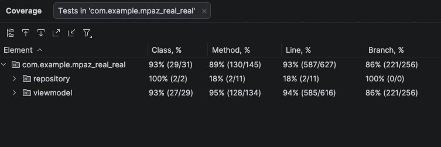
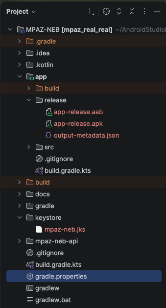

# MPAZ NEB

Aplicación Android de nivelación en Lectura y Matemática para estudiantes de 1.° a 4.° básico de la Escuela Escritora Marcela Paz. Se poseen tres perfiles: docente crea las actividades, asistente de aula las asigna y estudiante las responde con intentos y retroalimentación.

Proyecto del caso semestral de Desarrollo de Aplicaciones Móviles (DSY1105), Duoc UC. Todos los datos son ficticios: no hay nombres reales, RUT, diagnósticos ni notas.

## Integrantes:

- Javier Espinoza
- Luis Laffertte
- Benjamín Neira

## Funcionalidades implementadas:

### General

- Pantalla de carga con el logo de la escuela y el texto "Cargando...".
- Inicio de sesión en una sola ventana, con usuario y contraseña guardados en la base de datos local. Cada campo valida desde el ViewModel y muestra un ícono y un mensaje de error. Según el tipo de usuario, cada perfil entra a su propia pantalla.
- Diseño adaptable a teléfono y tableta (Window Size Class), y desplazamiento en horizontal.

### Estudiante

- Mis actividades: lista de actividades disponibles, con su estado y los intentos usados ("Intentos: N de M").
- Instrucciones y preguntas de Lectura (con texto de lectura) y de Matemática, con alternativas A, B y C, y una barra de avance.
- Respuesta obligatoria: no se puede avanzar sin elegir una alternativa (ícono + mensaje de aviso).
- Confirmación antes de enviar, control de intentos (Reintentar o Siguiente) y retroalimentación por pregunta.
- Pantallazo desde la Galería: el estudiante adjunta un pantallazo de la pregunta que más le costó.
- Guardar resumen en Archivos: crea un archivo de texto con el resultado del intento.
- Al final de la retroalimentación se muestra un Pokémon al azar desde la PokeAPI ("Tu Pokémon de hoy: ...").

### Docente (Administración pedagógica)

- Catálogo de actividades con filtros por módulo, curso, contenido y dificultad.
- Crear y editar actividades con formulario validado por campo (código LEC-### o MAT-### según el módulo, cantidad de preguntas e intentos permitidos), y agregar o quitar preguntas.
- Activar o desactivar una actividad; el estudiante solo ve las disponibles.
- Revisar una actividad con todas sus preguntas.
- Eliminar una actividad, con confirmación.
- Cada cambio se guarda en Room y se envía al microservicio (crear, editar, activar o desactivar y eliminar). Si no hay conexión, queda pendiente y se vuelve a enviar con "Reintentar".

### Asistente de aula

- Asignaciones: lista de actividades asignadas a estudiantes ficticios, con estado (pendiente, en desarrollo, finalizada).
- Asignar actividad: elegir una actividad con filtros, un estudiante, la hora límite y los minutos de duración. Se genera un código temporal de 6 dígitos.
- Resumen de la asignación con las respuestas, aciertos y errores.

## Aspectos técnicos

- Lenguaje y UI: Kotlin + Jetpack Compose (Material 3).
- Arquitectura MVVM: cada pantalla recibe su ViewModel; el estado vive en StateFlow y la validación está en los ViewModels, no en las pantallas.
- Navegación: Navigation Compose con rutas centralizadas en navigation/Screen.kt.
- Persistencia local: Room, base mpazneb_database con 7 tablas (usuarios, actividades, preguntas, resultados, estudiantes, asignaciones y respuestas). Los datos de ejemplo se cargan la primera vez que se abre la app.
- Animaciones: cambio de color al elegir una alternativa (animateColorAsState) y mensajes que aparecen con AnimatedVisibility.
- Recursos nativos: Galería (GetContent + Coil para mostrar la imagen) y Archivos (CreateDocument). No se usan cámara, micrófono, GPS ni contactos, como pide el caso.
- Consumo de API: Retrofit + Gson, con RetrofitInstance y ApiService para el microservicio, y PokeApiInstance y PokeApiService para la PokeAPI (carpeta data/remote).
- Microservicio propio: Spring Boot en la carpeta mpaz-neb-api, con base H2 por defecto.
- Pruebas unitarias: Kotest, MockK y kotlinx-coroutines-test.

## Endpoints utilizados:

### Microservicio propio (Spring Boot)

URL desde el emulador: http://10.0.2.2:8080. Documentación en Swagger: http://localhost:8080/swagger-ui.html

| Método | Ruta | Uso en la app |
|---|---|---|
| GET | /api/actividad | Listar las actividades del servidor |
| GET | /api/actividad?search={código} | Buscar una actividad por su código |
| POST | /api/actividad | Crear una actividad |
| PUT | /api/actividad/{id} | Editar, activar o desactivar una actividad |
| DELETE | /api/actividad/{id} | Eliminar una actividad |
| GET | /api/pregunta?actividad={código} | Listar las preguntas de una actividad |
| POST | /api/pregunta | Crear una pregunta |
| DELETE | /api/pregunta/{id} | Eliminar una pregunta |

### API externa (PokeAPI)

| Método | URL | Uso en la app |
|---|---|---|
| GET | https://pokeapi.co/api/v2/pokemon/{id} | Pokémon al azar (id entre 1 y 151) al final de la retroalimentación |

## Estructura de carpetas:

```
app/src/main/java/com/example/mpaz_real_real/
├── data/local/        Room: AppDatabase, dao/, entity/ y datos de ejemplo
├── data/model/        respuestas de las API (ActividadResponse, Pokemon)
├── data/remote/       Retrofit: RetrofitInstance, ApiService, PokeApiInstance y PokeApiService
├── model/             clases de datos y estados de pantalla (UiState)
├── navigation/        Screen.kt (rutas) y AppNavigation.kt (NavHost)
├── repository/        ActividadRepository, PokemonRepository y usuarios de prueba
├── ui/components/     componentes reutilizables
├── ui/screen/         pantallas
├── ui/theme/          colores, tipografía y tema
├── ui/utils/          utilidades de diseño (tamaño de ventana, colores por módulo)
└── viewmodel/         Carga, Login, Actividad y Catalogo
```

## Pasos para ejecutar:

1. Clonar el repositorio: git clone https://github.com/luisillo07/MPAZ-NEB.git
2. Levantar el microservicio: entrar a la carpeta mpaz-neb-api y ejecutar ./mvnw spring-boot:run (en Windows, mvnw.cmd spring-boot:run). Queda en el puerto 8080.
3. Abrir la carpeta del proyecto en Android Studio y esperar a que termine Gradle Sync.
4. Elegir un emulador con Android 10 (API 29) o superior.
5. Seleccionar la configuración app y presionar Run. Si el emulador pide el permiso de red local, aceptarlo.
6. Ingresar con alguna de las cuentas de prueba:

- Administración pedagógica: Usuario: docente, Contraseña: 1234
- Asistente de aula: Usuario: asistente1, Contraseña: 1234.1 / asistente2, Contraseña: 1234.2
- Estudiante: Usuario: estudiante1, Contraseña: 1234.1 (estudianteN donde N llega hasta 6)

Sin el microservicio la app igual funciona con Room, y el Catálogo muestra "Sin conexión con el servidor.".

Si la app ya estaba instalada con una versión anterior, conviene desinstalarla antes de ejecutar, para que se carguen los datos de ejemplo nuevos.

## Pruebas unitarias:

75 pruebas en app/src/test, sobre los ViewModels y los estados de pantalla, con la base de datos y las API reemplazadas por MockK. Se corren con clic derecho en com.example.mpaz_real_real (test) → Run 'Tests in 'mpaz_real_real''. Cobertura del paquete viewmodel: 94 % de líneas.



## APK firmado y llave:

- APK firmado con el asistente de Android Studio (release): app/release/app-release.apk. La configuración de la variante release está en app/build.gradle.kts
- Llave: keystore/mpaz-neb.jks (las contraseñas no están en el repositorio)




